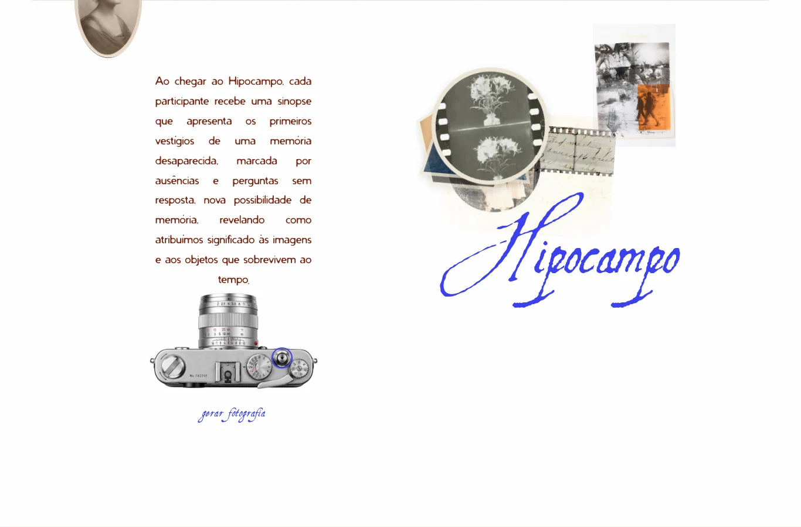

# Câmera e fotografias geométricas — 5 de novembro de 2026

A interação foi aplicada somente à câmera da seção Vestígios. O envelope da
página anterior conserva seu comportamento original.

Atualização: a [paleta aprovada e as fotos passageiras](color-story.md) distribuem
as fotos pela composição e removem cada uma após cinco segundos. A prévia abaixo
registra a entrega original da câmera, anterior à mudança dos fundos.

A [revisão dos fundos e das proporções](layout-restoration.md) restaura as fotos
originais da apresentação e suas medidas, preservando a dispersão e os cinco segundos.



## Comportamento

- Somente o disparador redondo, à direita do seletor de velocidades da câmera,
  gera fotografias. A lente, os outros comandos e o texto não são botões.
- “Gerar fotografia” indica a ação. O disparador é um botão nativo, também
  acionável por Enter, espaço e toque; em telas de toque, o alvo tem 44 pixels.
- Cada clique escolhe uma das nove fotografias locais em `images/trail/` e uma
  forma geométrica. O sorteio percorre cada conjunto antes de repeti-lo e evita
  repetições consecutivas, inclusive entre duas rodadas.
- As oito formas são círculo, triângulo, quadrado, hexágono, losango, pentágono,
  octógono e trapézio. O recorte afeta a fotografia e sua borda de papel.
- A foto sai do disparador e se revela em um ponto livre da composição, evitando
  texto e comandos. Cada uma se dissolve e é removida após cinco segundos.
- Cliques rápidos entram em sequência. Uma falha ao carregar uma imagem informa
  o problema e libera a próxima tentativa.
- A preferência por movimento reduzido mantém a revelação sem voo ou pulso e
  preserva o prazo de cinco segundos, com remoção direta.
  O leitor de tela recebe o número da fotografia e a forma revelada.

“Gerar” significa revelar uma fotografia existente com um novo recorte. Não há
serviço de IA, upload ou criação de conteúdo novo. A composição dura enquanto a
página estiver aberta e começa vazia após recarregar.

## Implementação

`page5-vestigios.js` usa a mesma instância local de GSAP já carregada pelo site.
O trabalho acontece ao clicar, sem ticker permanente ou leituras de geometria
por quadro. As imagens são decodificadas antes da revelação. A câmera tem suas
dimensões intrínsecas reservadas antes do carregamento para manter o disparador
alinhado e evitar saltos de layout.

`page5-vestigios.css` contém o alvo, os recortes e a disposição responsiva.
O HTML atualiza apenas as versões de cache desses dois arquivos. Não há nova
dependência de runtime, gesto de arrastar ou alteração na instalação 3D.

## Verificação

```bash
npm run build
node --check public/assets/page5-vestigios.js
python3 tools/camera-photos-qa.py
python3 tools/scroll-startup-qa.py
```

A rotina da câmera cobre cliques reais no disparador e fora dele, variação das
fotografias e dos recortes, teclado, cliques rápidos, limite de camadas, toque,
movimento reduzido, falha de imagem, rolagem, próxima seção e retorno.
As capturas e JSONs são salvos em `artifacts/camera-photos/`, ignorados no Git.

Passaram 24 verificações da câmera e 17 da primeira rolagem. O build e a sintaxe
foram verificados; o relatório visual está em `design-qa.md`. Não foram observadas
exceções JavaScript nem falhas de recursos locais nas visitas normais. A falha de
imagem é injetada deliberadamente em um contexto separado para testar a recuperação.

## Restauração

- Estado anterior: `7acf66c`, com a correção da primeira rolagem.
- Backup remoto: `backup/antes-camera-fotos-2026-11-05`.
- Entrega: `release/camera-fotos-geometricas-2026-11-05`.

Para desfazer somente esta interação, preservando o histórico:

```bash
git revert release/camera-fotos-geometricas-2026-11-05
git push origin HEAD:main
```

Preserve trabalho posterior ao resolver conflitos. Não use force push.
