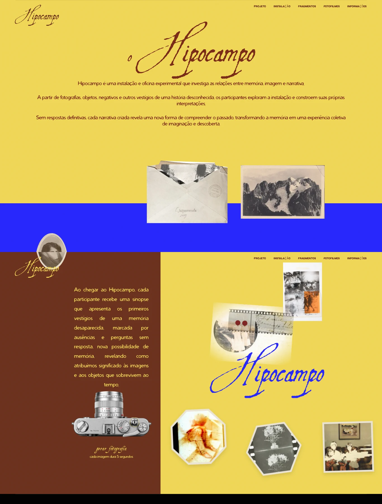

# Paleta e fotografias passageiras — 5 de novembro de 2026

**Registro da primeira entrega da paleta.** A revisão posterior restaura as
fotografias e a composição originais e simplifica os fundos. Consulte o
[estado atual e a comparação com a versão anterior à paleta](layout-restoration.md).

Aplicação da última prévia aprovada, com o marrom original dos textos da
apresentação preservado e fotos mais espalhadas que desaparecem em cinco segundos.



## Paleta e composição

- Apresentação: fundo `#f0d756`, textos e título mantidos em `#7a2a17`.
- Faixa inferior: `#2626fc`, revelada horizontalmente conforme o scroll e
  recomposta ao voltar. A camada não cria outro pin nem bloqueia a rolagem.
- Câmera: fundo `#6b311c` à esquerda e `#f0d756` à direita, marca em `#2626fc`.
  No celular, os campos se organizam verticalmente, acompanhando texto/câmera e colagem.
- O cabeçalho troca o contraste ao entrar no amarelo, azul e marrom. Fora dessas
  seções, volta às cores existentes.
- A saída da casa já consulta a cor da seção seguinte; acompanha o amarelo da
  apresentação sem alterar a geometria ou o controle da câmera 3D.

As fontes e os textos principais foram mantidos. O envelope conserva sua troca
de fotografias. A montanha usa `images/trail/photo-3.webp`, já existente no
projeto e presente na direção visual aprovada: a impressão enquadrada evita o
fundo branco da montagem anterior sobre os novos campos de cor.

## Fotografias e duração

O disparador continua sendo o único alvo da câmera. Cada clique escolhe uma
fotografia local e um dos oito recortes, evitando repetições consecutivas.

As fotos ocupam posições diferentes no espaço disponível. A distribuição mede
uma vez por clique e ao redimensionar, evitando texto, disparador, instruções e
marca. As imagens não interceptam ponteiros nem alteram a altura da seção.

Cada foto tem seu próprio prazo de 5.000 ms, contado a partir da criação. Nos
últimos 450 ms ela se dissolve; depois, elemento, animações e timers são liberados.
Uma nova foto não desloca as anteriores nem reinicia seus prazos. Cliques rápidos
continuam em sequência e não deixam uma pilha permanente. Ao retornar de uma aba
oculta, fotografias vencidas são removidas antes de reaparecerem.

Com movimento reduzido, a foto aparece sem voo e sai no prazo, sem dissolução.
Somente as nove fotografias locais já existentes são utilizadas; não há serviço
de geração de imagens, upload ou persistência entre recarregamentos.

## Arquivos e validação

- `page4-sobre.js`/`.css`: composição da apresentação e faixa de cor.
- `story-palette.js`: animação local da faixa e contraste do cabeçalho por seção.
- `page5-vestigios.js`/`.css`: campos de cor, revelação e prazo de cada foto.
- `camera-photo-layout.js`: distribuição sem sobrepor os elementos protegidos.
- `index.html`: versões de cache dos arquivos alterados.

```bash
npm run build
python3 tools/camera-photos-qa.py
python3 tools/color-story-qa.py
python3 tools/scroll-startup-qa.py
```

As rotinas cobrem os prazos individuais, remoção após cliques rápidos, teclado,
toque, falha/recuperação de imagem, posições, recortes, cores, faixa reversível,
contraste, saída da casa, movimento reduzido, resize e rolagem até a próxima seção.
Os JSONs e capturas ficam em `artifacts/color-story/` e `artifacts/camera-photos/`,
ignorados pelo Git. O relatório visual está em `design-qa.md`.

Resultado: **67 verificações aprovadas** — 27 da câmera, 23 da paleta e 17 da
rolagem inicial. Build e checagem de sintaxe também aprovados. Não houve exceções
JavaScript nem falhas de recursos locais nos percursos normais. A falha de imagem
injetada para testar recuperação ficou restrita ao cenário correspondente.

A [prévia conceitual aprovada](color-story-concept.webp) e a
[captura móvel](color-story-mobile.webp) acompanham as duas capturas desktop
acima. São registros da área visível; as posições das fotos variam a cada clique
e conforme o espaço disponível. A composição real preserva o texto e o layout
existentes, sem reproduzir as coordenadas fixas do conceito.

## Restauração

- Estado anterior: `6c1f822`, câmera com fotografias geométricas na composição branca.
- Backup remoto: `backup/antes-paleta-fotos-efemeras-2026-11-05`.
- Entrega: `release/paleta-fotos-efemeras-2026-11-05`.

Para desfazer somente esta entrega e preservar a câmera anterior:

```bash
git revert release/paleta-fotos-efemeras-2026-11-05
git push origin HEAD:main
```

Preserve trabalho posterior ao resolver conflitos. Não use force push.
