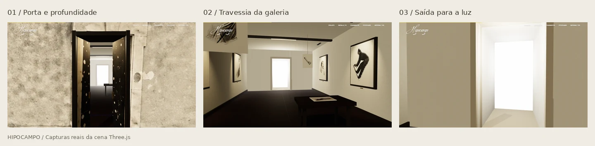

# Travessia da casa da memória

A casa do mapa conduz a uma galeria com geometria, iluminação e perspectiva.
A mesma câmera se aproxima da fachada, atravessa a porta articulada, passa entre
quadros e fotografias e cruza a abertura iluminada ao fundo. O scroll reverso
recompõe o percurso e fecha a porta.

A fachada fotográfica e os recortes originais permanecem como identidade do
mapa. A passagem e o interior são modelados: batentes profundos, folhas da porta
com espessura, piso de madeira, paredes, teto, trilhos de luz, quadros com suporte,
fotografias penduradas e mesa com uma impressão. A abertura em tela do shader
`paper-transition.js` não é utilizada.



## Encaixe e construção da entrada

A abertura acompanha os quatro cantos da porta na fotografia original
`peca-16-hd.webp` (1712×1408). Essa calibração orienta o recorte da fachada,
o stencil e a posição da entrada, preservando a pedra já presente na imagem.
O centro e o nível do piso também vêm dessa abertura. Ao substituir a foto,
atualize os pontos de referência em `house-doorway.js`.

O conjunto de madeira acompanha os eixos da abertura. O batente fica recuado
na pedra, com o eixo das dobradiças a 11,5 cm da fachada. Cada folha possui
estrutura com cerca de 5,6 cm de espessura, montantes, travessas, três painéis
rebaixados, bordas chanfradas, dobradiças e puxadores volumétricos. A textura
de nogueira existente recebe acabamento escuro, relevo e luz; a fotografia da
fachada não é mais esticada sobre as folhas.

O revestimento interno é estreito e permanece atrás do plano da foto para
evitar sobreposição. Uma soleira baixa em pedra escura integra o piso à entrada.
Uma luz suave ilumina a frente das folhas enquanto abrem. A legenda de entrada
desaparece entre 30% e 36% do percurso, antes do enquadramento fechado do batente.

## Balanço e oclusão da porta

Os seis quadros e as duas imagens suspensas respondem ao deslocamento do mouse
com um pêndulo amortecido. O pivô fica na borda superior, com limite de 4,3° nos
quadros e 14,3° nas imagens livres. O movimento desacelera ao parar o mouse, sem
arrastar a página; o touch continua dedicado ao scroll. A integração usa o
tempo entre frames e pequenos passos para manter o balanço estável.

Enquanto a câmera está fora, um stencil restringe a sala ao quadrilátero da porta.
Isso impede que paredes, piso e fundo apareçam nas partes transparentes da foto
ou além da lateral da casa. O recorte é desativado somente quando já preenche a
tela, antes de alcançar o near plane, e volta a funcionar no scroll reverso.
A porta e o batente mantêm geometria e profundidade próprias.

A fachada escreve profundidade como recorte opaco, com alpha-to-coverage, e é
desenhada antes das folhas da porta. A abertura da foto e o stencil têm as mesmas
medidas. A leve respiração da fachada termina antes da abertura, evitando
desalinhamento entre a foto e o batente fixo.
O parallax externo termina antes da trajetória interna, e a influência do mouse
sobre o olhar retorna gradualmente após abrir a porta. Não há troca brusca de
posição ou direção da câmera quando o cursor está nas bordas.

## Ritmo e continuidade

| Progresso aproximado | Acontecimento |
| --- | --- |
| 0–34% | A casa se aproxima; os fios desaparecem antes do enquadramento fechado |
| 29–48% | As duas folhas se abrem em profundidade |
| 34–56% | A câmera alcança e atravessa o batente |
| 56–86% | Percurso suave pela galeria, com discretos olhares laterais e parallax |
| 86–97% | Aproximação da passagem iluminada ao fundo |
| 97–100% | A arquitetura se dissolve na luz e a seção `#sobre` começa a aparecer |

O caminho usa uma spline tridimensional e parâmetros derivados do progresso,
sem trocar de câmera na entrada. As medidas de `#projeto` usam a altura final
do mapa, independente da sua animação inicial de escala. Isso mantém o
enquadramento ao voltar e ao atualizar o layout.

Uma sobreposição de 24svh deixa `#sobre` entrar no clarão final. Ela só é
aplicada enquanto a casa está disponível e o movimento não está reduzido.
Não há bloqueio de rolagem, pin adicional ou alteração dos controles da
instalação interativa mais abaixo na página.

## Arquivos

- `public/assets/page3-house.js`: mapa, câmera contínua, progresso, exposição,
  visibilidade, preferência de movimento e fallback.
- `public/assets/house-interior.js`: arquitetura, stencil, piso, coleção, luzes,
  adaptação da largura ao celular e descarte dos recursos.
- `public/assets/house-doorway.js`: calibração dos quatro cantos na foto,
  batente recuado, folhas articuladas, painéis, ferragens e luz da entrada.
- `public/assets/page3-house.css`: altura do percurso, viewport sticky, legendas
  e união com a próxima seção.
- `index.html`: módulos `?v=door-fit-1` e estilo `?v=depth-1` para invalidar o cache.

Usa o Three.js local, os recortes do mapa e as texturas/fotografias já existentes
no projeto. Nenhuma dependência de runtime foi adicionada. Apenas uma cena é
renderizada; o compositor com dois render targets foi retirado deste fluxo.
DPR limitado a 1,25, anisotropia limitada, um shadow map de 1024 atualizado na
abertura da porta e pausa fora da tela/aba oculta.

Com movimento reduzido, a galeria aparece estática em uma seção compacta, sem
zoom, parallax ou balanço. Falha de WebGL/textura e perda de contexto restauram
o mapa do DOM e removem o trecho sticky para preservar a leitura.

## Revisar e executar

Na pasta da aplicação:

```bash
npm run dev
npm run build
python3 tools/house-journey-qa.py
```

O QA usa `http://127.0.0.1:4173/`; ajuste `HIPOCAMPO_QA_URL` e
`HIPOCAMPO_CHROME` se necessário. Capturas e resultados ficam em
`artifacts/house-depth/`, fora do Git.
`document.querySelector('#casa').houseJourney.inspect()` expõe apenas o estado
da câmera, progresso, stencil, ângulos dos pêndulos e renderização para inspeção
no navegador. O QA compara pixels com/sem a sala para detectar qualquer vazamento
fora da abertura em seis pontos da aproximação, verifica dois frames parados
da porta e usa movimentos reais do mouse para testar o balanço dos dois tipos
de imagem.
Também compara a projeção dos quatro cantos da abertura com os pontos da foto,
verifica o volume e o recuo das folhas fechadas, a profundidade da abertura
nas dobradiças e a retirada da legenda do enquadramento fechado.

A validação em Chromium passou em 70 verificações, com viewports de 1366×768 e
390×844: passagem física, continuidade da câmera com o mouse fora do centro,
reversão, alinhamento com a fotografia, volume e recuo das folhas, dobradiças,
ausência de vazamento lateral, estabilidade da porta, balanço com o mouse,
resize, próxima seção, movimento reduzido, perda de contexto, ausência de WebGL
e assets locais.
Esses resultados verificam comportamento e renderização; não medem FPS em
aparelhos reais.

## Restauração

- Antes da travessia: `c8a0763`, tag `backup/casa-antes-travessia-2026-11-04`.
- Travessia inicial: tag `release/casa-travessia-2026-11-04`.
- Antes dos ajustes da porta e do balanço: `7b6fe74`, tag
  `backup/casa-antes-ajustes-porta-2026-11-04`.
- Ajustes da porta e do balanço: tag `release/casa-balanco-porta-2026-11-04`.
- Antes do novo encaixe: `4ecb628`, tag `backup/casa-antes-encaixe-2026-11-05`.
- Porta alinhada e remodelada: tag `release/casa-porta-perspectiva-2026-11-05`.

Para desfazer apenas estes ajustes, use
`git revert release/casa-porta-perspectiva-2026-11-05` e faça um push normal.
Não é necessário alterar as correções anteriores da sala
interativa ou da posição dos botões.
