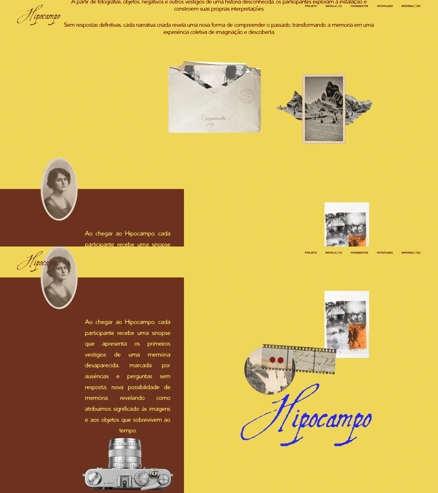

# Recorte do filme e definição da montanha — 5 de novembro de 2026

**Atualização de 6/11/2026:** os fundos de Sobre e Vestígios voltaram a `#fff`,
por solicitação do usuário. Texto marrom `#7a2a17`, controles azuis `#2626fc` e
cabeçalho marrom mantêm a leitura sobre o branco. As imagens tratadas, suas
medidas, posições e a dispersão com duração de cinco segundos foram preservadas.
[Prévia real atual](white-backgrounds-preview.webp).

Passaram 55 verificações da revisão branca (32 de composição e 23 de imagens),
incluindo a saída branca da casa, pixels da divisa, contraste e ausência de
overflow. Build e sintaxe aprovados. Resultados em `artifacts/white-backgrounds/`.
Backup: `backup/antes-fundos-brancos-2026-11-06` → `13cc1ec`.
Entrega: `release/fundos-brancos-2026-11-06`; para desfazer somente a volta ao
branco, use `git revert release/fundos-brancos-2026-11-06`.

O filme recebe um recorte transparente que acompanha a fotografia circular e a
tira de negativo, eliminando o retângulo claro. A montagem da montanha recebe
uma versão restaurada com maior resolução e contorno contínuo, preservando o
papel central e as rochas laterais. As medidas e posições na página permanecem
as mesmas, assim como os fundos, textos, marca, envelope e interação da câmera.



## Arquivos e procedência

| Imagem | Original preservado | Versão aplicada | Dimensões novas |
| --- | --- | --- | --- |
| Montanha | `images/sobre/montanha.webp` | `images/sobre/montanha-restaurada-v1.webp` | 1287×1222 |
| Filme | `images/vestigios/filme.webp` | `images/vestigios/filme-recortado-v1.webp` | 1483×1061 |

As duas versões foram tratadas com Image Gen a partir dos arquivos originais,
com instruções para manter o assunto, a composição e os tons. A restauração
assistida melhora a definição aparente; detalhes reconstruídos não equivalem
a informação recuperada do negativo original. Os arquivos antigos permanecem
intactos para referência e reversão.

Os PNGs derivados ficam em `/workspace/generated_images/`, respectivamente
`exec-b1c80811-421c-4ec4-9376-62636d1537bf.png` e
`exec-a844aa2a-c048-4031-b5f3-22aecc69ac3f.png`. Foram convertidos para WebP
com qualidade 94 e alpha 100, sem redimensionamento adicional. Total dos dois
assets: 645.238 bytes. O carregamento continua lazy.

A transparência pertence aos arquivos: o filtro de luminosidade da montanha e
a máscara radial do filme foram retirados. O filme mantém a caixa de proporção
960/688 para evitar mudança de layout; a montanha conserva a caixa 576/548.

## Validação e restauração

Passaram **55 verificações**: 23 de imagens/renderização e 32 de composição.
Incluem transparência nos cantos, opacidade da foto e das rochas, resolução,
comparação de cores sobre amarelo/branco, envelope, ausência de overflow, fontes,
medidas em quatro resoluções, contraste, câmera e navegação para a próxima seção.
Não houve exceção JavaScript ou falha de recurso local nas visitas normais.
Build e sintaxe aprovados.

```bash
python3 tools/photo-colors-qa.py
python3 tools/color-story-qa.py
npm run build
```

Capturas/comparação/JSONs em `artifacts/image-refinement/`; medidas em
`artifacts/layout-restoration/`. Backup anterior:
`backup/antes-recorte-nitidez-2026-11-05` → `8690275`.
Entrega: `release/recorte-nitidez-2026-11-05`. Para desfazer somente esta entrega:
`git revert release/recorte-nitidez-2026-11-05`, preservando trabalho posterior.
