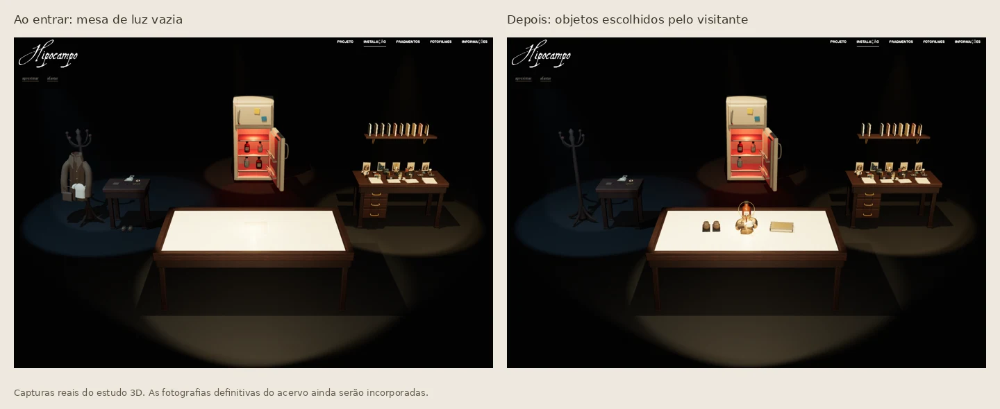

# Orientações da cliente — 5 de novembro de 2026

Aplicação dos dois áudios e da lista recebida por mensagem. Os áudios originais
e a transcrição de trabalho não são publicados junto com o site.



## Alterações

- Retirar os nomes flutuantes das quatro áreas da sala.
- Deixar a mesa branca vazia ao entrar e após recompor. Cada visitante escolhe
  os objetos que deseja aproximar nela.
- Manter roupas e acessórios no conjunto do cabideiro; livros, fotografias e
  demais objetos na escrivaninha; químicos na geladeira.
- Permitir transferir, posicionar e devolver todos os objetos por mouse,
  teclado, toque ou lista acessível. Preservar o giro 360°, zoom e a saída da sala.
- Retirar somente a entrada aleatória das letras da abertura. Manter o movimento
  com o mouse, as fotografias e a transição do círculo.
- Abrir o espaçamento do título e das linhas do Projeto e separar o texto em
  quatro parágrafos, preservando a redação. No layout empilhado, reservar um
  viewport para o mapa antes da casa, para a transição não cobrir a leitura.

A cliente aprovou a casa e as outras composições fotográficas. Elas permanecem.
Ela ainda enviará novos títulos/fontes para a instalação; não foi inventada uma
nova redação para substituir “instalação virtual” e “uma sala, muitas vidas”.

## Acervo e fotografias pendentes

`public/assets/installation-collection.js` preserva as 75 posições numeradas.
Casaco/camiseta/bolsa e linha/agulha/tecido são conjuntos únicos. Cartas, discos,
porta-retratos, livros e documentos mantêm entradas independentes conforme a
numeração. As cartas 5–7 compartilham a indicação de enquadramento.

O número de CDs ainda não foi informado. A posição 72 possui `variants: []`:
preencha uma variante por fotografia e `expandCollection` produzirá um objeto
independente para cada CD, sem deixar as imagens coplanares na origem.

As fotografias definitivas dos itens não acompanharam a lista. A sala usa
volumes de estudo e imagens já presentes no projeto, sem inventar biografias,
autoria de cartas ou histórias pessoais. Os documentos de estudo usam apenas
nomes genéricos e linhas sem conteúdo pessoal. Esses modelos não são as
fotografias originais do acervo.

Para cada fotografia final, preencha `image` com o caminho local e `imageAspect`
com largura/altura da imagem. O conjunto inteiro passa a ser representado por
uma impressão fotográfica. Para CDs, preencha esses campos em cada variante.
A apresentação na mesa é calculada pelo volume real do objeto, preservando a
escala e a rotação originais quando ele é devolvido.

A distribuição inicial dos números 1, 41, 57, 62, 63, 64 e 69 representa roupas
e acessórios. Os demais registros numerados ficam na escrivaninha. Quatro
frascos de estudo, separados da numeração 1–75, representam os químicos pedidos
no áudio e podem sair da geladeira. A direção de arte pode ajustar `island` e
`position` no catálogo quando confirmar o espaço físico.

## Arquivos

- `installation-collection.js`: catálogo, agrupamentos, imagens e posições.
- `installation-props.js`: volumes de estudo substituíveis por fotografias.
- `installation-scene.js`: apresentação, transferência e devolução dos objetos.
- `installation-room.js` e `.css`: interface e busca na alternativa acessível.
- `hero-motion.js`: letras visíveis imediatamente, mantendo a interação.
- `page2-motion.js` e `.css`: parágrafos, espaçamento e leitura responsiva.

## Validação

Build estático e verificações de sintaxe passaram. As verificações de navegador
passaram em três rotinas:

| Rotina | Verificações |
| --- | ---: |
| `python3 tools/installation-qa.py` | 30 |
| `python3 tools/installation-navigation-qa.py` | 22 |
| `python3 tools/installation-client-qa.py` | 38 |

Foram exercitados mouse, toque nativo, teclado, busca, todos os registros na mesa,
devolução, recomposição, luz vermelha, giro 360°, zoom, movimento reduzido,
ausência de WebGL e rolagem até a próxima seção. O arraste foi conferido a partir
do cabideiro, da prateleira, do chão, da escrivaninha e da geladeira.

A leitura do Projeto e a ida/volta da casa passaram em 1366×768, 1024×768 e
390×844. A instalação também foi verificada em 1592×1132, 1600×900 e 375×667.
Não foram observadas exceções de JavaScript ou falhas de recursos locais nos
runs registrados. As capturas e os JSONs ficam em `artifacts/`, ignorados no Git.
Esses testes não medem FPS em aparelhos reais.

## Restauração exata desta entrega

- Versão salva: `fc98a3f` (inclui a porta ajustada da casa).
- Backup remoto: `backup/antes-audios-cliente-2026-11-05`.
- Entrega: `release/cliente-audios-2026-11-05`.

“Desfaça essa última coisa” corresponde a reverter esta entrega inteira para o
estado salvo, preservando os ajustes anteriores. Use:

```bash
git revert release/cliente-audios-2026-11-05
git push origin HEAD:main
```

Não use reset ou force push. Se houver trabalho posterior, preserve-o durante
a reversão. Nenhuma dependência de transcrição é necessária para executar o site.
