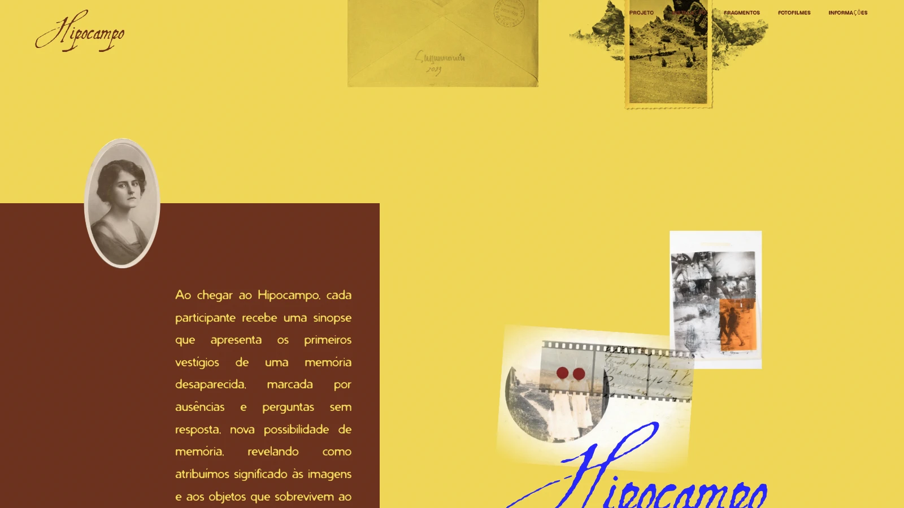

# Composição original e fundos simplificados — 5 de novembro de 2026

A correção atende ao pedido de preservar as fotos, posições e proporções que
existiam antes da aplicação da paleta. A apresentação mantém somente o fundo
amarelo `#f0d756` e o texto marrom original `#7a2a17`. A faixa azul inferior e a
borda amarela adicional foram removidas. O retrato oval volta a atravessar a
divisa direta com o campo marrom `#6b311c` da seção seguinte. À direita, o amarelo
continua na colagem; a marca permanece azul `#2626fc`.



## Fotografias e medidas

- `page4-sobre.js` foi restaurado integralmente a partir de `6c1f822`.
- `page4-sobre.css` corresponde à mesma versão, alterando somente a cor de fundo.
- A montagem original `images/sobre/montanha.webp` volta à proporção 576/548,
  posição e tratamento anteriores. Envelope, retrato, fontes e texto são os originais.
- A câmera perde a borda e a linha adicional de duração, que alteravam a altura.
  A região móvel da colagem volta a 110vw, como antes da paleta.
- As fotos geradas mantêm o tamanho visual anterior: 18vw × 0,85 = 15,3vw no
  desktop, 45vw × 0,85 = 38,25vw no celular. A compensação existe porque agora
  a galeria é posicionada diretamente na seção para permitir maior dispersão.
- As fotografias continuam saindo somente pelo disparador, variando entre oito
  recortes, espalhando-se e desaparecendo individualmente após cinco segundos.
- A imagem da câmera não permite arraste ou seleção acidental. O arquivo
  prateado original permanece o mesmo.

## Validação

`python3 tools/color-story-qa.py` compara a implementação com os quatro arquivos
reais de `6c1f822`, servidos apenas ao navegador de referência. As medidas de
texto, título, envelope, retrato, montanha, câmera, colagem, filme e marca são
comparadas em 1600×900, 1366×768, 390×844 e 375×667, incluindo o tamanho visual
das fotos geradas e os caminhos das imagens. A referência nunca modifica o site.

Também são verificados os pixels da passagem entre as seções, a travessia do
retrato, o envelope por teclado, contraste, dispersão, rolagem de retorno,
movimento reduzido, overflow e a saída amarela da casa. A rotina
`python3 tools/camera-photos-qa.py` verifica o disparador e os prazos individuais.
Capturas e JSONs ficam em `artifacts/layout-restoration/` e `artifacts/camera-photos/`.

Resultado: **59 verificações aprovadas** — 32 de composição/fundos e 27 da
câmera. As quatro comparações de geometria não apresentaram diferenças acima
de 0,75 px. Build e sintaxe aprovados, sem exceções JavaScript ou recursos locais
indisponíveis nos percursos normais. A recuperação de imagem é testada com uma
falha deliberadamente injetada em cenário separado.

[Captura móvel da composição restaurada](layout-restoration-mobile.webp).

## Histórico e restauração

- Referência original de composição: `6c1f822`.
- Backup anterior à correção: `backup/antes-restaurar-composicao-2026-11-05`,
  apontando para `95d0d1b`.
- Entrega desta correção: `release/composicao-restaurada-2026-11-05`.

Para desfazer somente esta correção, preservando trabalho posterior:

```bash
git revert release/composicao-restaurada-2026-11-05
git push origin HEAD:main
```
